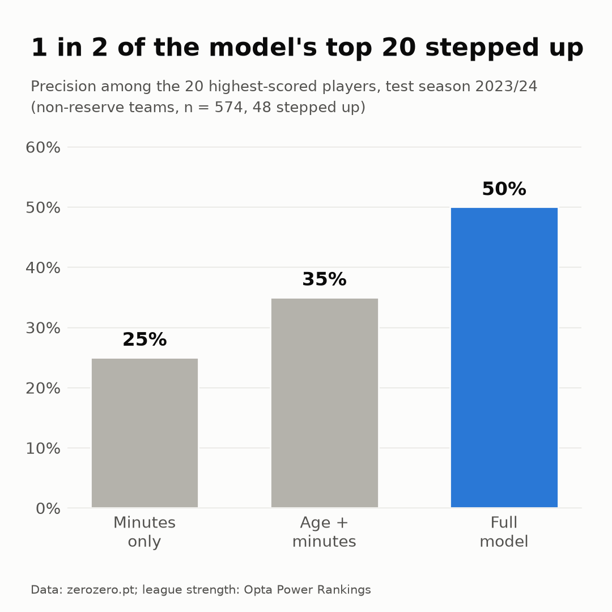
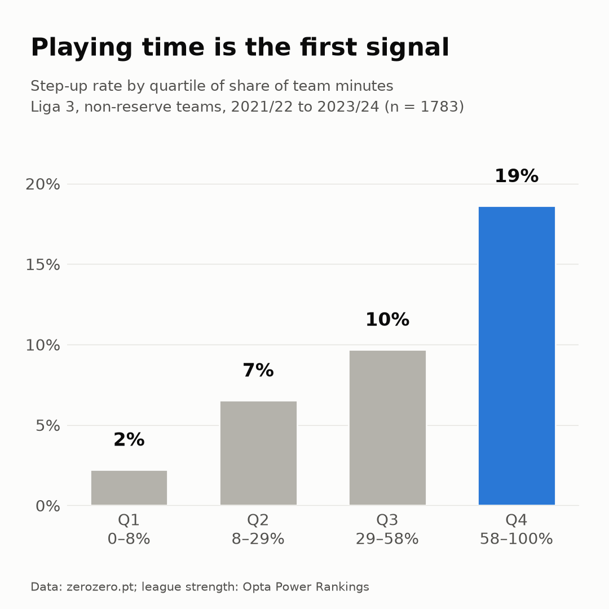
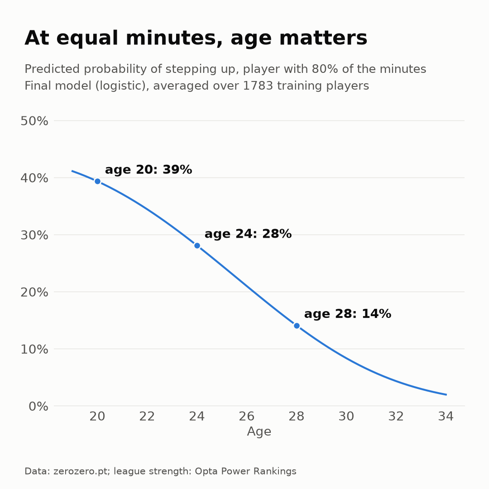
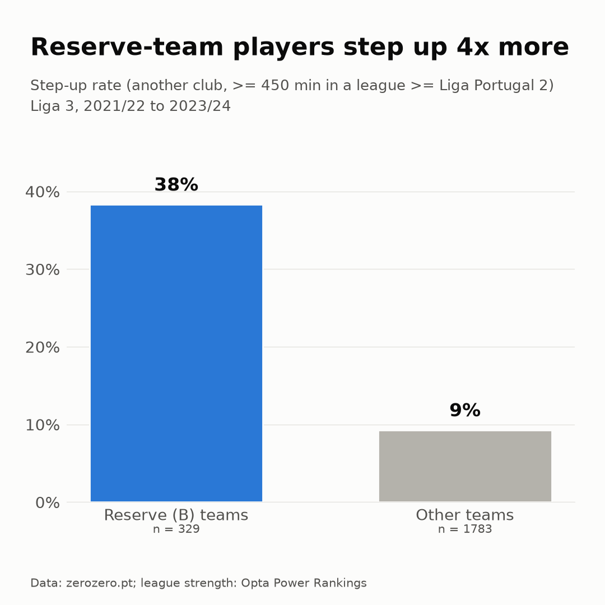
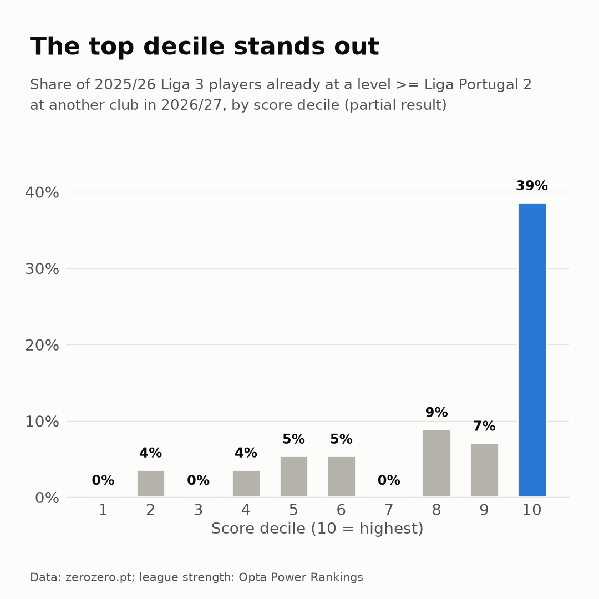

# Scouting Liga 3: who steps up from Portugal's third tier?

On the 2023/24 test season, half of the model's top 20 stepped up to Liga 2 or
higher, twice the rate of ranking by minutes alone.

A model that ranks players of the Portuguese **Liga 3** by their chance of
reaching a higher level within the next two seasons. It is built only from
public match sheets and player profiles.

Portuguese competition names used below:

| Name | What it is |
|---|---|
| **I Liga** (Liga Portugal) | top tier |
| **Liga Portugal 2** ("Liga 2") | second tier, professional |
| **Liga 3** | third tier, created in 2021/22 |
| **Campeonato de Portugal** | fourth tier |
| **B teams** | reserve teams of professional clubs (e.g. "Sporting B"); several play in Liga 3 |

## The problem

Liga 3 has around 600 non-reserve players per season. Each year a few dozen of
them move up to Liga 2, the I Liga or a comparable foreign league. Most clubs
cannot watch every match. The question is:

> Using only what a Liga 3 season shows (minutes, age, team context, goals,
> on-pitch goal difference), can we rank players so that the ones who will
> step up are near the top?

The output is a ranking, not a verdict. It is meant to tell a scout whom to
watch first.

## Data and ethics

- **Source.** Match sheets, season calendars and player profiles come from
  [zerozero.pt](https://www.zerozero.pt). Four Liga 3 seasons were collected:
  2021/22 to 2023/24 (labelled) and 2025/26 (ranked).
- **Polite collection.**
  - One request at a time, with a 5–6 s pause and a 3-minute break every 80 requests.
  - The User-Agent names the project and a contact address.
  - On a second consecutive failure the run stops instead of retrying.
- **Local cache.** Every page is stored on disk the first time and is never
  requested again. All later steps run offline: `SCOUTING_OFFLINE=1` turns any
  cache miss into an error instead of a request.
- **Nothing is redistributed.** This repository contains no scraped pages,
  no tables, no player-level results and no league ratings. Anyone who runs it
  collects their own copy, at the same pace. Players are linked across tables
  by the source's numeric id, never by name.
- **League strength.** Foreign leagues are compared with the **Opta Power
  Rankings** (Stats Perform / The Analyst). Their terms allow personal,
  non-commercial use and do not allow republishing. So
  [`config/opta_leagues.example.toml`](config/opta_leagues.example.toml) ships
  the league mapping and leaves out the ratings, which you fill in yourself.

## Target definition

The unit is one player-season in Liga 3 (s). A player **stepped up** if, summed
over seasons s+1 and s+2, he played **at least 450 league minutes** in a league
of at least Liga Portugal 2 level:

- **I Liga or Liga Portugal 2** always count.
- **A foreign league** counts if its Opta average team rating is at least the
  rating of Liga Portugal 2. Leagues without a rating count as below.
- **Only league minutes count.** Cups, youth leagues and continental club
  competitions are excluded, and minutes are counted per club.
- **The move must be individual: the minutes must come at another club.** A
  player whose own team was promoted, and who reached 450 minutes only with
  that team, is left out of the main target (label not observed). Being
  promoted with your club says little about the individual.

Two thresholds about half a point either side of the Liga 2 rating are kept as sensitivity
variants. A player-season with no career data at all in s+1/s+2 counts as 0 and
is flagged for a sensitivity check.

## Method

- **Features** (all from season s or earlier):
  - age (centred, with a squared term);
  - share of possible team minutes;
  - team points per game in the first phase;
  - on-pitch goal difference per 90 relative to the team;
  - percentile of goals per 90 within the player's position;
  - a low-minutes flag, with per-90 rates imputed from the training median;
  - position from the starting line-ups (GK/DF/MF/FW/unknown);
  - level in the previous season (professional or foreign / Portuguese senior / youth or no record).
- **Model.** L2-regularised logistic regression with standardised inputs. The
  regularisation strength C is chosen by an inner cross-validation on the
  training set only. A LightGBM model was compared in cross-validation and did
  not beat it. Two simple baselines are reported alongside:
  - (a) minutes only;
  - (b) age + minutes.
- **Scope.** Non-reserve teams only. Reserve-team players step up about four
  times as often (38% vs 9%), but mostly through their own club's structure. They
  are described separately, not modelled.
- **Temporal and grouped split:**
  - Test season: 2023/24.
  - Training seasons: 2021/22 and 2022/23, excluding every player who also
    appears in 2023/24, so no test player is seen in training.
  - Cross-validation inside the training set uses GroupKFold by player.
  - Everything learnt from data (medians, percentiles, scaling) is fitted inside
    each training fold.
- **Reading the test set.** The test was read three times, always with the same
  model, features and C-selection procedure. Each new reading followed a
  documented fix to the labels, never to the model:
  1. Calendar-year seasons (Brazil, the USA, Scandinavia, ...) were not matched
     to s+1/s+2.
  2. The source's per-club games page ignores the club filter, so league minutes
     were mixing clubs, cups and youth leagues.
  3. The destination rule changed from a hand-made country/tier grouping to the
     Opta league ratings.

  The third reading is final, and the test set is closed: the evaluation script
  refuses to run again.

## Results (aggregated)

**Test season 2023/24:** 574 non-reserve players, of whom 48 (8.4%) stepped up
individually. The training set had 820 player-seasons with 97 positives.

| Model | PR-AUC | ROC-AUC | Precision top 20 | Precision top 50 |
|---|---|---|---|---|
| (a) minutes only | 0.19 | 0.73 | 25% | 18% |
| (b) age + minutes | 0.24 | 0.81 | 35% | 28% |
| **full model** | **0.40** | **0.84** | **50%** | **36%** |

Half of the model's top 20 stepped up, twice the rate of ranking by playing time
alone. The base rate is 8%.

 

Playing time is the strongest single signal. At equal minutes, age matters a
lot: the predicted probability for a player with 80% of the minutes falls from
about 39% at 20 to 14% at 28.

 

**Out of sample, 2025/26 → 2026/27 (partial, descriptive).** The final model was
retrained on all three labelled seasons (1,783 player-seasons, 165 positives).
It was then used to rank the 579 non-reserve players of 2025/26, a season it had
never seen.

By November 2026, 39% of the players in the top score decile were already at a
Liga 2-or-higher club other than their own. No other decile was above 9%. This
is a partial check:
- the season is half played;
- being at a club is not the same as playing 450 minutes;
- it was never used to change the model.



## Limitations

- **Small sample.** Three labelled seasons and 48 positives in the test. A top-20
  precision of 50% means 10 players, so the uncertainty is wide.
- **Not a single blind read.** The test was read three times. The model never
  changed, but the labels did, and the reasons are documented above.
- **One ratings snapshot.** League ratings come from a single Opta snapshot
  (2026/27 season) applied to destinations from 2022/23 onwards. League
  strength moves over time.
- **The data source is incomplete.** Profiles sometimes miss seasons or clubs,
  and minutes abroad depend on how the source records each league.
- **450 minutes is a low bar.** It means the player reached the level, not that
  he became established there.
- **Calibration.** The model ranks well but is over-confident at the top: the
  top test decile averaged 0.60 predicted vs 0.35 observed. Read the scores as a
  ranking, not as probabilities.
- **Feature limits.**
  - Match-sheet data only: no event data, no physical or video information.
  - Position comes from line-ups. 2021/22 sheets have no tactical view, so that
    season uses the profile position.
- **Not modelled:**
  - reserve (B) team players;
  - the 2024/25 season (not collected).

## How to run it

Each user collects their own data. A full season takes about 90 minutes at the
polite pace. Python 3.11+ is required (tested on 3.13).

```bash
python -m venv .venv
source .venv/bin/activate              # Windows: .venv\Scripts\activate
pip install -r requirements.txt
pip install -e .
export SCOUTING_CONTACT_EMAIL=you@example.com   # required, goes in the User-Agent
cp config/opta_leagues.example.toml config/opta_leagues.toml
# then fill in the ratings and the threshold in config/opta_leagues.toml
```

**1. Collection** (network; resumable; no requests for pages already cached)

```bash
python scripts/collect_season.py --season 2021/22   # likewise 2022/23, 2023/24, 2025/26
python scripts/build_minutes.py                      # parse cached pages into Parquet tables
python scripts/collect_club_divisions.py             # division of foreign destination clubs
python scripts/build_target.py --collect             # future league minutes, in stages
```

Use `--dry-run` on the last two to count the missing pages first.

**2. Tables, checks, target, features** (offline)

```bash
python scripts/build_minutes.py
python -m pytest                                     # unit tests + data checks
python scripts/validation_report.py
python scripts/build_target.py
python scripts/feature_signal.py
```

**3. Model** (offline)

```bash
python scripts/train_cv.py                           # cross-validation report
python scripts/cv_checks.py                          # fold comparison and calibration
python scripts/evaluate_test.py                      # one-time test evaluation
```

**4. Ranking, destinations, figures**

```bash
python scripts/rank_season.py --destinations
python scripts/destinations_next.py --fetch
python scripts/make_figures.py
```

Reports are written to `reports/` in Portuguese, the project's working language.
Known, explained source problems can be listed in `validation_exceptions.csv`
(columns `check, match_id, team, reason`); they are left out of the data checks.
Without `data/`, the data-check tests are skipped and the unit tests still run.

The labelled and ranked seasons are set in `LABELLED_SEASONS`
(`src/scouting/model.py`) and `RANK_SEASON` (`scripts/rank_season.py`). A season
gets a complete label two years later, when s+2 ends.

## Project structure

```
src/scouting/
  config.py              paths, User-Agent, request pacing
  http.py                cached, rate-limited HTTP client (offline mode)
  sources/zerozero.py    URLs and requests for the source
  parsing/zerozero.py    parsers for match sheets, calendars, profiles, team pages
  minutes.py             minutes rules (substitutions, red cards, extra time)
  tables.py              matches / appearances / goal_events / players / calendar
  season.py              player-team-season aggregation
  validation.py          data consistency checks
  destinations.py        foreign league tiers and calendar-year seasons
  target.py              target variable (Opta rule, league minutes per club)
  features.py, model.py  features, fold-safe preprocessing, model helpers
  report.py              shared report writing
scripts/                 pipeline steps, in the order above
tests/                   pytest: parsing, minutes, aggregation, target, model, data checks
config/
  foreign_leagues.toml         calendar-year countries, league tiers
  opta_leagues.example.toml    league mapping; ratings left out (see the file)
reports/figures/         aggregated charts (no player names)
```

## Author

João Fernandes, BSc Artificial Intelligence and Data Science, University of Évora.
[LinkedIn](https://www.linkedin.com/in/jo%C3%A3o-briosa-fernandes-20420b430/)
